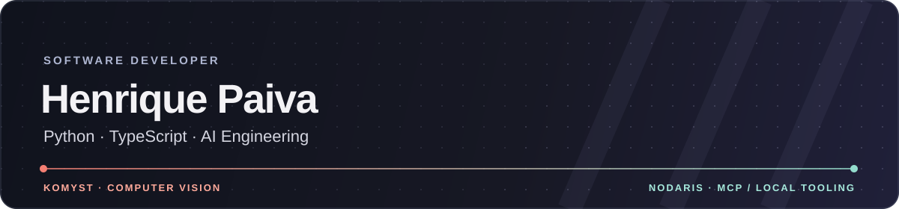
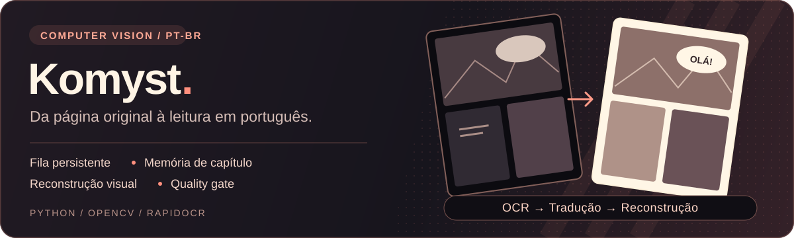
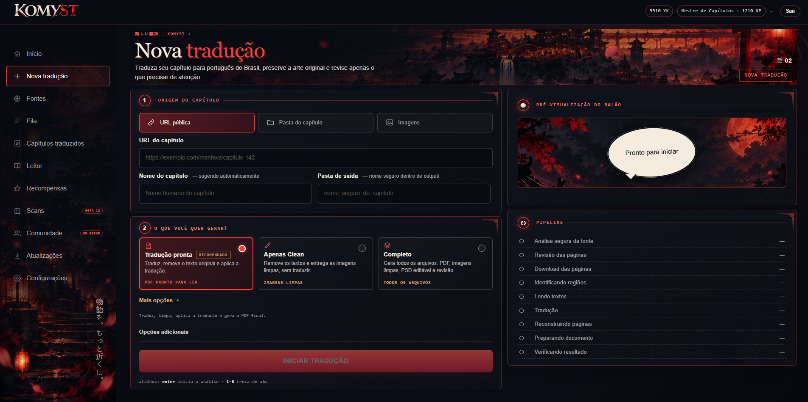
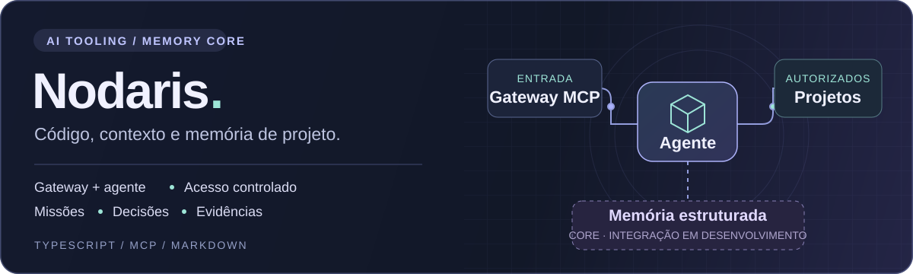

[Português](README.md) · [English](README.en.md)

[Projects](#featured-projects) · [Technologies](#technologies-and-practices) · [Contact](#contact)

## About me

I am studying **Systems Analysis and Development (ADS)** and work in IT support. I build tools that bring together artificial intelligence, automation, and software engineering.

Investigating failures, diagnosing environments, and solving real problems shape how I build software. I am currently focused on two projects: **Komyst**, for visual processing of illustrated chapters, and **Nodaris**, infrastructure that connects AI assistants to explicitly authorized local projects.

## Featured projects

### Komyst — Visual processing with AI

**Computer Vision · OCR · AI Pipeline · Python**

Komyst automates the processing and translation of illustrated chapters. It combines text recognition, region classification, translation through an authenticated service, and image reconstruction.

- **Visual pipeline:** uses RapidOCR for text recognition, classifies regions, and reconstructs image areas with computer vision techniques.
- **Persistent execution:** stores the queue and job states in SQLite and processes jobs with isolated workers.
- **Explicit quality checks:** validates text and images and flags results that need human inspection.
- **Service integration:** requests translations through an authenticated backend.

A job can produce a PDF and still end in `review_required`: processing has finished, but the result needs review. Technical completion does not mean visual approval.

**Stack:** Python · OpenCV · RapidOCR · SQLite

**Status:** technical beta; visual fidelity and flagged cases are still being validated.

[**Explore the project**](https://github.com/HenriquePvAr/Komyst) · [Architecture](https://github.com/HenriquePvAr/Komyst/blob/main/docs/ARCHITECTURE.md) · [Tests](https://github.com/HenriquePvAr/Komyst/blob/main/docs/TESTING.md) · [Known issues](https://github.com/HenriquePvAr/Komyst/blob/main/docs/KNOWN_ISSUES.md)

---

### Nodaris — AI assistants connected to local projects

**Developer Tooling · MCP · TypeScript · Local Infrastructure**

Nodaris lets AI assistants inspect files, code, and project information without giving them unrestricted access to the computer. The Model Context Protocol (MCP) connects the client to a Gateway and a local agent.

`AI assistant → MCP client → local Gateway → local agent → authorized project`

- **Controlled access:** the operator explicitly chooses which folders and projects the agent can inspect.
- **Developer tools:** file reading, code search, and Git repository inspection.
- **Local execution:** the Gateway and agent communicate over loopback by default; the portable runtime protects per-user credentials.
- **Writes disabled in the portable runtime:** it supports reading and Git inspection; writing to projects or memory is not enabled.

The repository includes a structured memory core; its operational integration into the portable runtime is still in development.

**Stack:** TypeScript · Node.js · MCP · PowerShell

**Status:** read-only portable runtime available for Windows.

[**Explore the project**](https://github.com/HenriquePvAr/Nodaris) · [Installation](https://github.com/HenriquePvAr/Nodaris/blob/main/docs/guides/INSTALLATION_NEW_PC.md) · [Security](https://github.com/HenriquePvAr/Nodaris/blob/main/docs/security/SECURITY.md)

## Technologies and practices

| Area | Technologies and experience |
|---|---|
| Development | Python, TypeScript, Node.js |
| AI and computer vision | OCR, OpenCV, RapidOCR, MCP, and LLM integration |
| Backend and data | APIs, authentication, SQLite, and persistence |
| Engineering | Isolated workers, testing, debugging, and access control |
| Infrastructure | Git, Windows, PowerShell, and automation |

## Contact

I am studying ADS and work in IT support. I am interested in software engineering, applied AI, developer tools, and automation. Open to professional opportunities and collaboration.

[**LinkedIn**](https://www.linkedin.com/in/henrique-paiva-14076a367) · [**Email**](mailto:henriquepaiva128@gmail.com) · [**GitHub**](https://github.com/HenriquePvAr)
