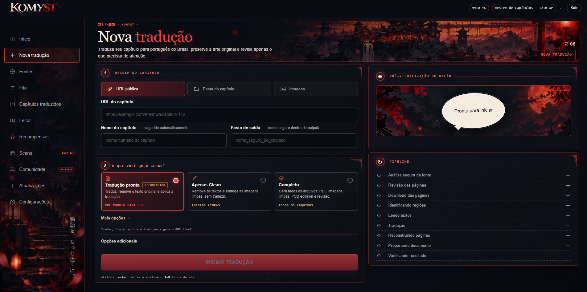
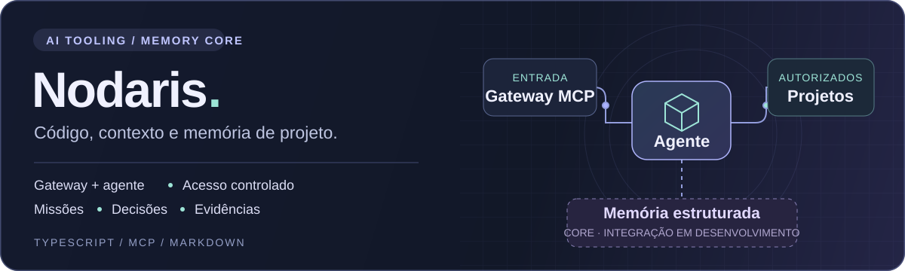

# Henrique Paiva

**Software Developer · Python · TypeScript · AI Engineering**

Desenvolvo ferramentas na interseção entre **inteligência artificial, automação e engenharia de software**.

Gosto de trabalhar nos problemas que aparecem depois que uma funcionalidade começa a funcionar: confiabilidade, persistência, integração entre serviços, qualidade e controle de acesso.

[Projetos](#projetos-em-destaque) · [Tecnologias](#tecnologias-e-práticas) · [LinkedIn](https://www.linkedin.com/in/henrique-paiva-14076a367)

---

## Sobre mim

Sou estudante de **Análise e Desenvolvimento de Sistemas** e atuo profissionalmente com suporte de TI.

Minha experiência investigando falhas, diagnosticando ambientes e resolvendo problemas reais influencia diretamente a maneira como desenvolvo software.

Atualmente, concentro meus estudos e desenvolvimento em dois projetos pessoais: o **Komyst**, voltado ao processamento visual com IA, e o **Nodaris**, uma infraestrutura que conecta assistentes inteligentes a ferramentas e projetos locais.

## Projetos em destaque

### Komyst — Processamento visual com inteligência artificial

**Computer Vision · OCR · AI Pipeline · Python**

O Komyst nasceu de um desafio: automatizar o processamento e a tradução de capítulos ilustrados sem perder de vista a composição visual das páginas.

O sistema combina reconhecimento de texto, classificação de regiões, tradução por um serviço autenticado e reconstrução de imagens em um fluxo de processamento organizado.

**O que existe por trás da interface**

- **Pipeline visual:** reconhecimento de texto com RapidOCR, classificação contextual e reconstrução de regiões utilizando técnicas de visão computacional.
- **Execução resiliente:** fila persistente em SQLite, workers isolados e acompanhamento dos estados de processamento.
- **Controle de qualidade:** verificações de texto e imagem, com sinalização dos resultados que exigem inspeção humana.
- **Integração com serviços:** autenticação e comunicação com um backend responsável pelas solicitações de tradução.

O desafio não é apenas obter um texto traduzido. É coordenar diferentes etapas, preservar o resultado visual e identificar quando uma execução terminou sem necessariamente atingir a qualidade desejada.

**Stack:** Python · OpenCV · RapidOCR · SQLite

**Situação atual:** beta técnica em desenvolvimento e validação. Resultados visuais ainda podem exigir revisão.

[**Explorar o projeto**](https://github.com/HenriquePvAr/Komyst) · [Arquitetura](https://github.com/HenriquePvAr/Komyst/blob/main/docs/ARCHITECTURE.md) · [Testes](https://github.com/HenriquePvAr/Komyst/blob/main/docs/TESTING.md)

---

### Nodaris — Conectando assistentes de IA a projetos locais

**Developer Tooling · MCP · TypeScript · Local Infrastructure**

O Nodaris surgiu de uma necessidade prática: permitir que assistentes de IA consultem arquivos, código e informações de projetos locais sem receber acesso indiscriminado ao computador.

A infraestrutura utiliza o **Model Context Protocol (MCP)** para conectar clientes de IA a um Gateway e a um agente local que trabalham sobre projetos explicitamente autorizados.

**O que o Nodaris oferece**

- **Acesso controlado:** seleção explícita das pastas e projetos disponíveis ao agente.
- **Ferramentas de desenvolvimento:** leitura de arquivos, pesquisa em código e inspeção do histórico e estado de repositórios Git.
- **Infraestrutura local:** Gateway e agente com comunicação em loopback por padrão, identidade e credenciais próprias por usuário.
- **Arquitetura extensível:** separação entre comunicação MCP, autorização, execução local e um núcleo de memória estruturada em desenvolvimento.

O objetivo é tornar a colaboração entre desenvolvedores e assistentes de IA mais contextualizada, auditável e controlada.

**Stack:** TypeScript · Node.js · MCP · PowerShell

**Situação atual:** runtime portátil de leitura disponível para Windows. Escrita em projetos e integração operacional da memória permanecem em desenvolvimento.

[**Explorar o projeto**](https://github.com/HenriquePvAr/Nodaris) · [Instalação](https://github.com/HenriquePvAr/Nodaris/blob/main/docs/guides/INSTALLATION_NEW_PC.md) · [Segurança](https://github.com/HenriquePvAr/Nodaris/blob/main/docs/security/SECURITY.md)

---

## Tecnologias e práticas

| Área | Tecnologias e conhecimentos |
|---|---|
| Desenvolvimento | Python, TypeScript, Node.js |
| Inteligência artificial | Integração com LLMs, OCR, visão computacional, MCP |
| Backend e dados | APIs, SQLite, autenticação e persistência |
| Engenharia | Git, automação, testes, depuração e isolamento de processos |
| Infraestrutura | Windows, PowerShell e ferramentas de desenvolvimento |

### Como procuro construir software

Prefiro soluções que possam ser compreendidas, testadas e diagnosticadas.

Nos meus projetos, isso se traduz em separar responsabilidades, registrar estados de execução, estabelecer permissões explícitas e documentar limitações técnicas.

Não considero uma funcionalidade confiável apenas porque funcionou uma vez. Entender seu comportamento diante de falhas também faz parte do desenvolvimento.

---

## Vamos nos conectar?

Tenho interesse em **engenharia de software, IA aplicada, ferramentas para desenvolvedores, automação e qualidade de software**.

Estou aberto a oportunidades profissionais, conversas técnicas e colaborações em projetos.

[**LinkedIn**](https://www.linkedin.com/in/henrique-paiva-14076a367) · [**E-mail**](mailto:henriquepaiva128@gmail.com) · [**GitHub**](https://github.com/HenriquePvAr)
