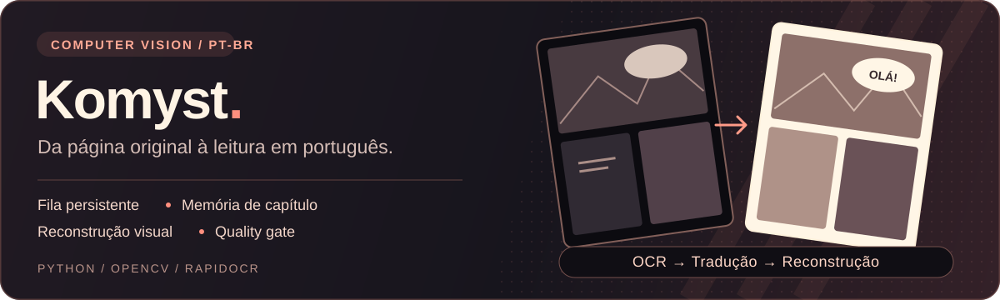

<div align="center">


[Português](README.md) · [English](README.en.md)

[Projetos](#projetos-em-destaque) · [Tecnologias](#tecnologias-e-práticas) · [Contato](#contato)

</div>

## Sobre mim

Sou estudante de **Análise e Desenvolvimento de Sistemas** e atuo profissionalmente com suporte de TI. Desenvolvo ferramentas que integram inteligência artificial, automação e engenharia de software.

Investigar falhas, diagnosticar ambientes e resolver problemas reais influencia a maneira como construo software. Atualmente, concentro meus estudos e desenvolvimento em dois projetos: **Komyst**, para processamento visual de capítulos ilustrados, e **Nodaris**, uma infraestrutura que conecta assistentes de IA a projetos locais autorizados.

## Projetos em destaque

### Komyst — Processamento visual com inteligência artificial

**Computer Vision · OCR · AI Pipeline · Python**

O Komyst automatiza o processamento e a tradução de capítulos ilustrados. Ele combina reconhecimento de texto, classificação de regiões, tradução por um serviço autenticado e reconstrução de imagens.

<a href="https://github.com/HenriquePvAr/Komyst"></a>

<details>
  <summary>Visualizar interface do Komyst</summary>
  <br>
  
</details>

- **Pipeline visual:** usa RapidOCR para reconhecer texto, classifica regiões e reconstrói áreas da imagem com técnicas de visão computacional.
- **Execução persistente:** mantém a fila e os estados no SQLite, com workers isolados para processar os jobs.
- **Qualidade explícita:** valida texto e imagem e sinaliza resultados que precisam de inspeção humana.
- **Integração com serviços:** solicita traduções por meio de um backend autenticado.

Um job pode gerar um PDF e ainda terminar como `review_required`: o processamento concluiu, mas o resultado ainda precisa de revisão. Conclusão técnica não significa aprovação visual.

**Stack:** Python · OpenCV · RapidOCR · SQLite

**Situação:** beta técnica; fidelidade visual e casos sinalizados seguem em validação.

[**Explorar o projeto**](https://github.com/HenriquePvAr/Komyst) · [Arquitetura](https://github.com/HenriquePvAr/Komyst/blob/main/docs/ARCHITECTURE.md) · [Testes](https://github.com/HenriquePvAr/Komyst/blob/main/docs/TESTING.md) · [Limitações](https://github.com/HenriquePvAr/Komyst/blob/main/docs/KNOWN_ISSUES.md)

---

### Nodaris — Assistentes de IA conectados a projetos locais

**Developer Tooling · MCP · TypeScript · Local Infrastructure**

O Nodaris permite que assistentes consultem arquivos, código e informações de projetos locais sem receber acesso indiscriminado ao computador. O Model Context Protocol (MCP) conecta o cliente ao Gateway e ao agente local.

<a href="https://github.com/HenriquePvAr/Nodaris"></a>

`Assistente de IA → cliente MCP → Gateway local → agente local → projeto autorizado`

- **Acesso controlado:** o operador escolhe explicitamente quais pastas e projetos o agente pode consultar.
- **Ferramentas de desenvolvimento:** leitura de arquivos, pesquisa em código e inspeção de repositórios Git.
- **Execução local:** Gateway e agente se comunicam em loopback por padrão; o runtime portátil protege as credenciais por usuário.
- **Escrita bloqueada no runtime portátil:** ele oferece leitura e inspeção Git; escrita em projetos e memória não está habilitada.

O repositório inclui um núcleo de memória estruturada; sua integração operacional no runtime portátil permanece em desenvolvimento.

**Stack:** TypeScript · Node.js · MCP · PowerShell

**Situação:** runtime portátil de leitura disponível para Windows.

<details>
  <summary>Ver saída real de uma consulta MCP (sanitizada)</summary>

Consulta executada pelo Nodaris em 16/11/2026. O identificador local e o caminho absoluto foram omitidos.

```text
nodaris_health
{"status":"ok","projects":1}

nodaris_project_tree (projeto: Nodaris, profundidade: 2)
README.md
package.json
apps/
docs/
tests/
```
</details>

[**Explorar o projeto**](https://github.com/HenriquePvAr/Nodaris) · [Instalação](https://github.com/HenriquePvAr/Nodaris/blob/main/docs/guides/INSTALLATION_NEW_PC.md) · [Segurança](https://github.com/HenriquePvAr/Nodaris/blob/main/docs/security/SECURITY.md)

## Tecnologias e práticas

| Área | Tecnologias e conhecimentos |
|---|---|
| Desenvolvimento | Python, TypeScript, Node.js |
| IA e visão computacional | OCR, OpenCV, RapidOCR, MCP e integração com LLMs |
| Backend e dados | APIs, autenticação, SQLite e persistência |
| Engenharia | Workers isolados, testes, depuração e controle de acesso |
| Infraestrutura | Git, Windows, PowerShell e automação |

## Contato

Estou aberto a oportunidades profissionais, conversas técnicas e colaborações em engenharia de software, IA aplicada, ferramentas para desenvolvedores e automação.

[**LinkedIn**](https://www.linkedin.com/in/henrique-paiva-14076a367) · [**E-mail**](mailto:henriquepaiva128@gmail.com) · [**GitHub**](https://github.com/HenriquePvAr)
