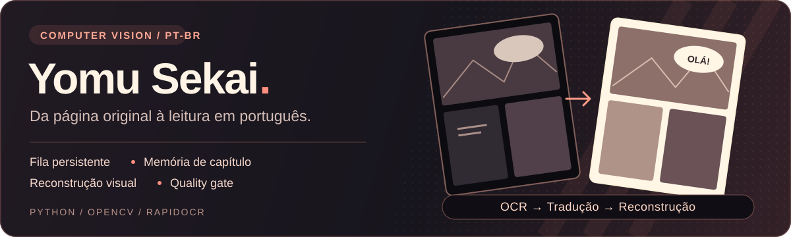
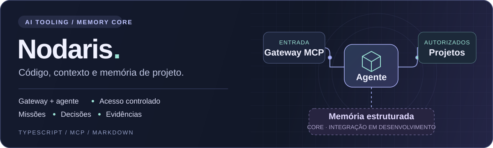

# Olá, eu sou o Henrique.

**Python · TypeScript · Automação · IA aplicada**

Sou estudante de **Análise e Desenvolvimento de Sistemas** e desenvolvo ferramentas com **Python e TypeScript**. Meu foco está em automação, integração de APIs e inteligência artificial aplicada a problemas concretos.

Também trabalho com **suporte técnico**. Investigar falhas, entender o que o usuário precisa e encontrar a causa de um problema fazem parte da minha rotina — e da forma como construo software.

## O que estou construindo

### Yomu Sekai · tradução com visão computacional

Desenvolvo um aplicativo que transforma capítulos ilustrados em versões traduzidas para português. Ele reúne aquisição de páginas, reconhecimento e classificação de texto, tradução contextual, reconstrução da imagem e diagramação das falas — com PDF, imagens e arquivos de revisão como saída.

| Camada | Como funciona |
| :--- | :--- |
| **Interface e execução** | A UI grava jobs em uma fila SQLite. Um worker supervisionado executa cada job em um processo próprio e persiste progresso e resultados. |
| **Pipeline visual e linguístico** | Adapters coletam as páginas; RapidOCR identifica texto; a classificação contextual distingue falas, narração e SFX. A tradução passa por backend autenticado, com o motor remoto no servidor. |
| **Memória de capítulo** | Um ledger de terminologia e um registro de personagens mantêm nomes e formas canônicas consistentes dentro do capítulo. Cache e artefatos persistidos permitem reutilizar etapas válidas. |
| **Reconstrução e qualidade** | Máscaras, inpainting e ajuste tipográfico recompõem as páginas. Validações antes e depois da renderização registram evidências e encaminham casos duvidosos para revisão humana. |

**Python · OpenCV · RapidOCR · SQLite** 
Beta técnica em desenvolvimento · memória de terminologia limitada ao capítulo.

[Explorar o Yomu →](https://github.com/HenriquePvAr/Tradutor.Ia) · [Arquitetura e processos](https://github.com/HenriquePvAr/Tradutor.Ia/blob/main/docs/technical/DOCUMENTACAO_TECNICA.md)

---

### Nodaris · contexto de projeto para assistentes de IA

Desenvolvo uma infraestrutura para conectar assistentes de IA a projetos locais com acesso controlado. Além de consultar arquivos, pesquisar código e inspecionar Git, o projeto tem um núcleo de memória estruturada para preservar o contexto do trabalho entre sessões: o que foi tentado, por que uma decisão foi tomada e quais evidências sustentam cada conclusão.

| Camada | Como funciona |
| :--- | :--- |
| **Gateway MCP + agente local** | O Gateway expõe as ferramentas aos clientes de IA; o agente valida cada solicitação e acessa somente as pastas autorizadas. Os processos se comunicam por HTTP autenticado e rodam em loopback por padrão. |
| **Registry e permissões** | O desenho de autorização vincula repositório, workspace e vault por identidade. Leitura, escrita de memória e escrita de projeto têm escopos próprios; uma não libera a outra. |
| **Núcleo de memória** | Vault Markdown como fonte de verdade, com missões, bugs, tentativas, decisões, experimentos, evidências e sessões relacionados por IDs. Histórico e resumos de continuidade distinguem relato, observação de teste e verificação Git. |
| **Escrita controlada** | O core separa proposta, aprovação e aplicação, com revisão esperada, hashes e recibos vinculados ao preview. A integração operacional depende dos gates locais de autorização, segurança e recuperação. |

**TypeScript · Node.js · MCP · Markdown / Obsidian** 
O runtime portátil publicado oferece leitura de projetos e Git. O núcleo de memória existe no repositório; sua habilitação no runtime portátil e a escrita em projetos continuam em desenvolvimento.

[Explorar o Nodaris →](https://github.com/HenriquePvAr/Nodaris) · [Arquitetura de memória](https://github.com/HenriquePvAr/Nodaris/blob/main/docs/architecture/NODARIS_MEMORY_BLUEPRINT.md)

## Como penso software

**Entender o problema → construir → testar → melhorar.**

Gosto de projetos que conectam diferentes tecnologias e entregam algo utilizável. Tenho interesse tanto na interface que a pessoa vê quanto no processo que faz tudo funcionar por trás.

---

  <strong>Vamos construir alguma coisa?</strong> 
  Aberto a projetos, troca de conhecimento e oportunidades em desenvolvimento.  
  <a href="mailto:henriquepaiva128@gmail.com">henriquepaiva128@gmail.com</a>

